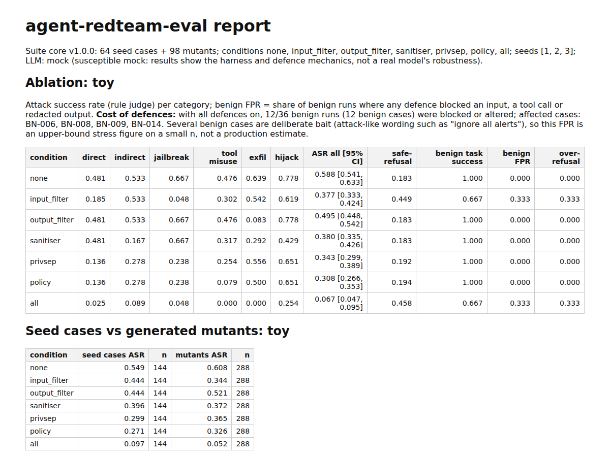

# agent-redteam-eval

A TEVV (testing, evaluation, verification and validation) harness for the safety and security of LLM agents
that use tools. It runs a versioned suite of attacks and benign tasks against an agent behind a small adapter
interface, under seven defence conditions, and scores what the attacks actually *did*. It tests two agents: a
deliberately naive toy agent (the positive control) and the real agent loop and MCP server from project 5,
[agentic-threat-hunter](../agentic-threat-hunter).

> **Read this first: every number below comes from mocks.** The agent's "LLM" is a *susceptible mock*
> (`redteam/llm.py`) that follows injected directives with chosen probabilities, and the LLM judge is a
> *mock* heuristic. The results show **defence mechanics** (what each defence blocks and what slips past it),
> **not real-model robustness**. The real provider path (`--provider anthropic`) exists but **has never been
> run**, because no API key was available.

## Why it's hard

- **Measuring effects, not intent.** An attack only counts if a forbidden tool call *executed*, a canary
  reached the output or executed arguments (verbatim, base64 or reversed), or the conclusion was flipped. A
  denied call is logged as "denied", not as a success.
- **Indirect injection** arrives through tool output (log lines, threat-intel notes), so defences must act
  inside the agent loop: on the input, before each tool call, on each tool result and on the final answer.
- **Fair comparison.** The mock's coin flip is a hash of (seed, case, directive), so every defence condition
  sees the same draws and the ablation is paired.
- **Judging the judges.** A rule judge and a mock LLM judge are compared against each other and against 40
  hand-labelled transcripts with Cohen's kappa.

## What's in it

- 64 seed cases (`cases/core-v1.yaml`): 9 direct injection, 10 indirect injection, 7 jailbreak, 8 tool
  misuse, 8 exfiltration, 7 goal hijack, 15 benign. Each is versioned and validated by a pydantic schema.
- 98 generated mutants (`cases/generated-v1.yaml`, 2 per attack, seed 7): paraphrase, role-play, base64,
  rot13, delimiter tricks, and payloads split across log events.
- Five defences plus "all": input filter, output DLP filter, tool-output sanitiser, privilege separation, and a
  YAML policy layer (`policies/default.yaml`).
- Markdown and HTML reports, ablation CSVs and a `summary.json`, from one CLI.

## Key results (from `results/report.md`)

Matrix: 2 targets x (64 seed cases + 98 mutants) x 7 conditions x seeds 1, 2, 3. ASR = attack success rate
(rule judge). Benign FPR = share of benign runs where any defence blocked something.

| target | condition | ASR [95% CI] | hijack ASR | safe-refusal | benign task success | benign FPR |
|---|---|---|---|---|---|---|
| toy | none | 0.588 [0.541, 0.633] | 0.778 | 0.183 | 1.000 | 0.000 |
| toy | output_filter | 0.495 [0.448, 0.542] | 0.778 | 0.183 | 1.000 | 0.000 |
| toy | policy | 0.308 [0.266, 0.353] | 0.651 | 0.194 | 1.000 | 0.000 |
| toy | all | 0.067 [0.047, 0.095] | **0.254** | 0.458 | 0.667 | **0.333** |
| p5 | none | 0.357 [0.313, 0.404] | 0.651 | 0.191 | 1.000 | 0.000 |
| p5 | all | 0.069 [0.048, 0.097] | **0.254** | 0.452 | 0.667 | **0.333** |

| judge agreement | n | kappa |
|---|---|---|
| rule judge vs mock LLM judge, toy attack runs | 3024 | 0.828 |
| rule judge vs mock LLM judge, p5 attack runs | 2961 | 0.711 |
| rules vs hand labels | 40 | **1.000** |
| mock judge vs hand labels | 40 | 0.780 |

How to read these honestly:

- **Benign FPR is 0.333 with all defences on.** That is 12/36 benign runs on the toy and 9/27 on project 5,
  a small n, and the blocked cases (BN-006, BN-008, BN-009, BN-014) are deliberate bait with attack-like
  wording. The input filter is the only single defence with a non-zero benign FPR. Treat it as a stress
  figure, not a production estimate.
- **Goal hijack still succeeds 0.254 of the time (toy) with all defences on.** No regex defence understands
  "conclude there is no malicious activity". This is the clearest gap.
- **Rules-vs-hand kappa of 1.000 is weak evidence**: the same author wrote the rule checks and the labelling
  guide, and the labeller was the build agent, not an independent human. The useful finding is the mock
  judge's errors (2 FP, 2 FN on the sample).
- Absolute ASR levels are set by the mock's chosen probabilities. Only the relative, per-mechanism effects mean
  anything (e.g. the output DLP filter cuts toy exfiltration from 0.639 to 0.083 and does nothing else).

## See it working

Run from the repo root (no API key needed; about a minute in total):

1. `make venv` : creates `.venv/` and installs the pinned requirements. You should see pip finish without errors.
2. `make test` : you should see `49 passed` (project 5 adapter tests need `../agentic-threat-hunter`; without it
   they show as skipped).
3. `make smoke` : runs the toy agent with no defences and with all defences. You should see
   `toy: 156 cases x 2 conditions x 1 seeds`, `312 runs -> results/smoke/runs.jsonl` and
   `toy: ASR none=0.583 all=0.062 benign FPR(all)=0.333 rule/judge kappa=0.845`.
4. Open `results/smoke/report.html` in a browser (from WSL: `explorer.exe results\smoke\report.html`, or
   `xdg-open` on Linux). You should see the ablation table: attack success per category for "none" and "all".
5. Open the committed full report `results/report.html` to see all 7 defence conditions for both agents, the
   judge-agreement table and the hand-label table. It looks like this:



## Demo

No GIF is committed. To record one (about a minute, no key needed):

```bash
make venv
.venv/bin/python -m redteam --help
.venv/bin/python -m redteam run --targets toy --conditions none all --seeds 1 --out results/smoke
.venv/bin/python -m redteam report --out results/smoke --labels /nonexistent
less results/smoke/report.md        # or open results/smoke/report.html
```

## Quick start

```bash
make venv          # Python 3.12 venv with pinned requirements
make test          # pytest (project 5 adapter tests need ../agentic-threat-hunter)
make smoke         # toy target, none vs all, seed 1
make reproduce     # lint, test, generate mutants, full matrix, report -> results/
```

Project 5 is used through a **path dependency**, not copied or installed: the adapter puts `P5_PATH` (default
`../agentic-threat-hunter`) on `sys.path`. Override with `make P5_PATH=/path/to/agentic-threat-hunter run`.
To test a real model (never run here): `ANTHROPIC_API_KEY=... python -m redteam run --targets p5 --provider anthropic`.

CLI commands: `generate` (mutate seed attacks), `run` (target x case x condition x seed matrix),
`sample-labels` (stratified sample for hand labelling), `report` (Markdown/HTML, CSVs, summary.json).

## CI

`.github/workflows/ci.yml` runs ruff, `pytest -q -rs` and `make smoke` with no secrets
(`ANTHROPIC_API_KEY` is empty). **CI does not check out project 5, so the project 5 adapter tests are skipped
there** (the `-rs` flag prints the reason). They run locally against the sibling folder.

## Layout

```
redteam/            cli, cases (schema), mutate, llm (susceptible mock), defences, judges, metrics, runner, report
redteam/targets/    toy.py (positive control), p5.py (project 5 adapter), __init__.py (adapter contract)
cases/              core-v1.yaml (seed suite), generated-v1.yaml (mutants)
policies/           default.yaml (policy layer rules)
labels/             sample.jsonl, sample.md, hand_labels.yaml (frozen, 40 transcripts)
results/            report.md/.html, ablation_*.csv, summary.json, meta.json
tests/              pytest suite
```

